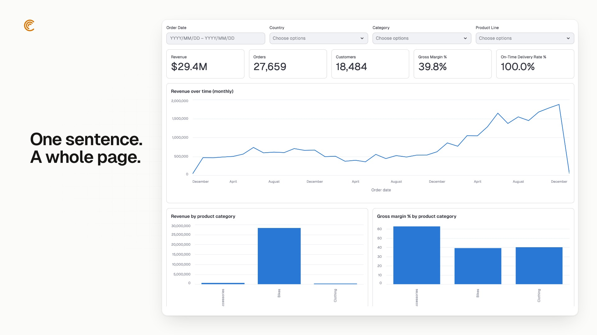
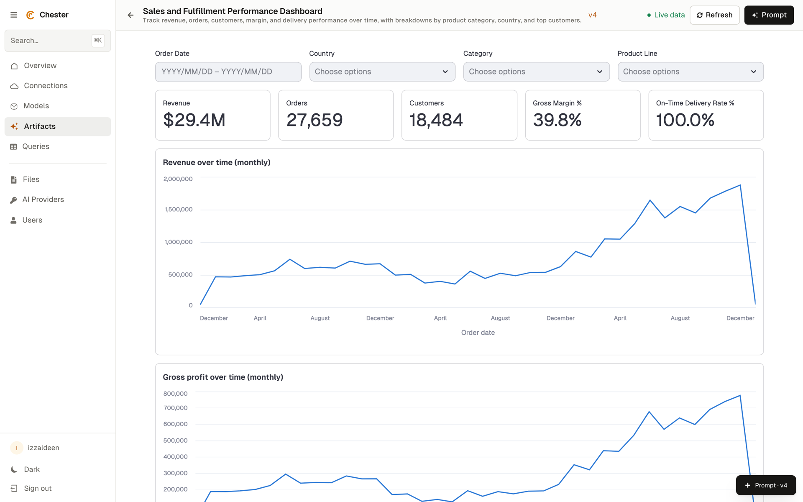
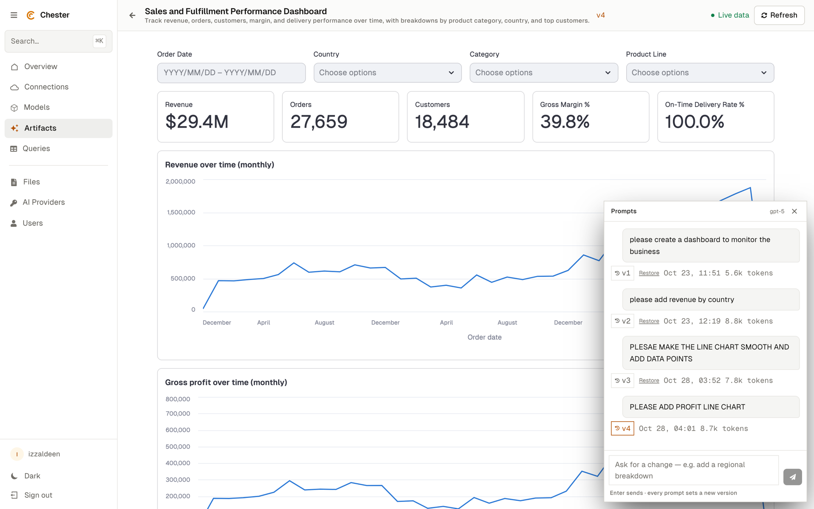
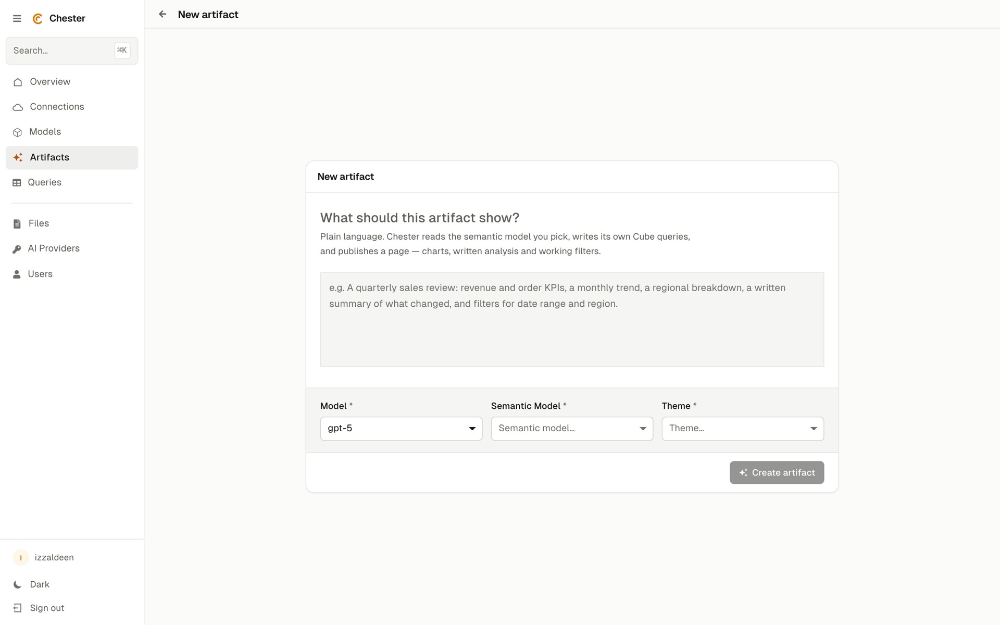
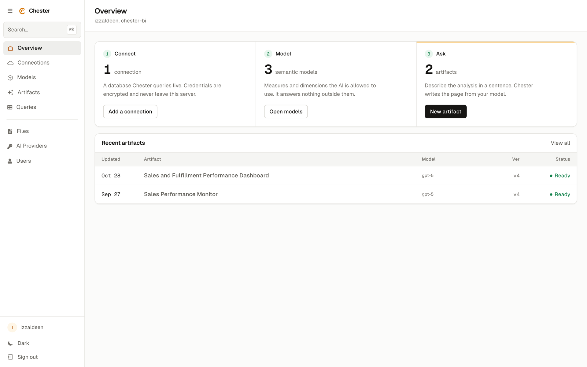
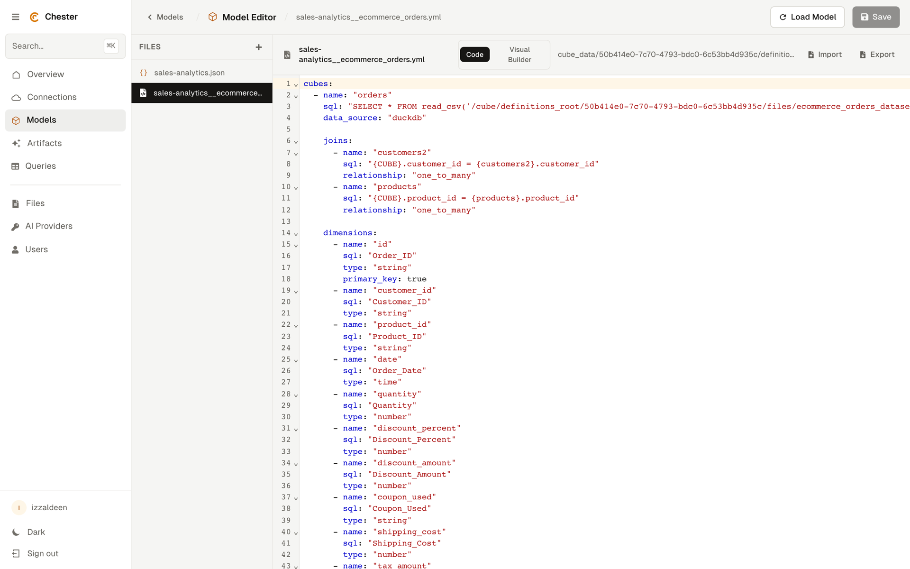
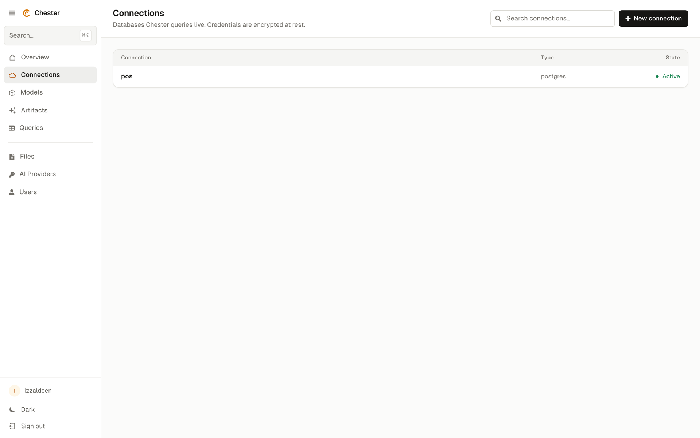
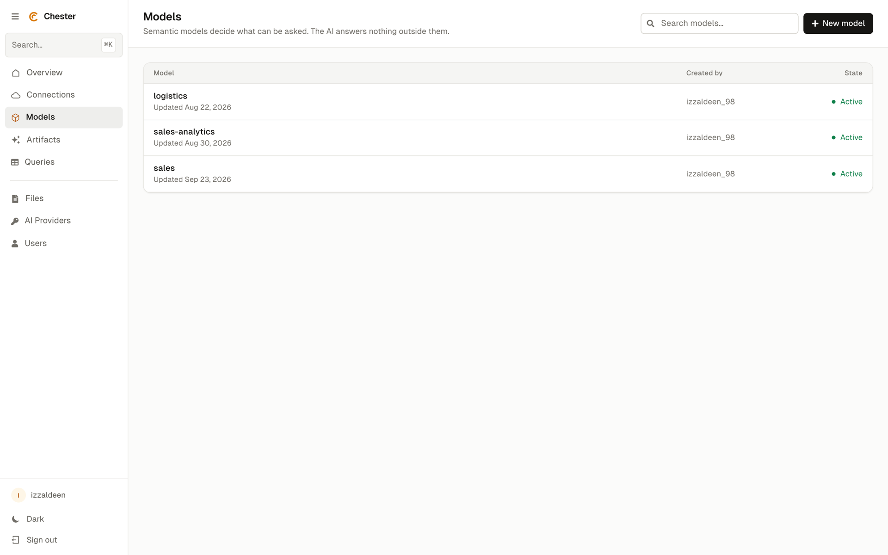

<div align="center">

<picture>
  <source media="(prefers-color-scheme: dark)" srcset="assets/brand/chester-horizontal-dark.svg" />
  
</picture>

<h3>Self-hosted, open-source BI. Describe the analysis, and the AI builds the page.</h3>

[](LICENSE)
[](https://www.python.org/)
[](https://fastapi.tiangolo.com/)
[](https://react.dev/)
[](https://cube.dev/)
[](https://docs.docker.com/compose/)
[](https://github.com/izzaldeen98/chester-bi)

[**Quick Start**](#quick-start) · [**Features**](#features) · [**Screenshots**](#screenshots) · [**Roadmap**](ROADMAP.md) · [**Report a Bug**](https://github.com/izzaldeen98/chester-bi/issues)

<br/>

<a href="brag.mp4"></a>

<sub>▶ Click to watch the launch video</sub>

</div>

---

## Why Chester BI?

Chester BI runs on **your own infrastructure**. Connect your databases, model them as
[Cube](https://cube.dev/) semantic cubes, then **describe the analysis you want in plain
language**. An AI agent reads your semantic model, writes the queries and builds a complete
page: KPIs, charts, written analysis and working filters. The page queries live data
every time it opens.

> **No dashboard canvas. No chart configuration. A semantic model and a sentence.**

<table>
<tr>
<td width="33%" valign="top">

### 🔌 1. Connect
Point Chester at PostgreSQL, MySQL, SQL Server, SQLite, ClickHouse, BigQuery, Snowflake,
or upload CSV/Parquet files. Credentials are encrypted at rest.

</td>
<td width="33%" valign="top">

### 🧊 2. Model
Define measures and dimensions in a visual builder or in YAML. The model decides what can
be asked. The AI can't see anything outside it.

</td>
<td width="33%" valign="top">

### ✨ 3. Ask
Describe the page you want. Chester writes validated Cube queries and builds the page
from them. Every follow-up prompt saves a new version.

</td>
</tr>
</table>

### The semantic layer is the guardrail

The LLM gets your compiled Cube schema and nothing else: **no rows, no connection
strings, no SQL**. Every query it writes is checked against the live schema before it runs.
A hallucinated field, or a measure used as a dimension, is rejected and sent back to the
model instead of being executed.

Bring your own LLM key: **OpenAI, Anthropic, Gemini, DeepSeek or Qwen**. Only your
prompt and your schema leave your servers.

---

## Screenshots

<div align="center">

<picture>
  <source media="(prefers-color-scheme: dark)" srcset="assets/screenshots/artifact-dark.png" />
  
</picture>

<sub><b>An artifact.</b> Filters, KPIs and charts the agent chose from one sentence, with live data on every open.</sub>

</div>

<br/>

<table>
<tr>
<td width="50%" align="center">

<br/><sub><b>Versioned by prompt.</b> Every change request is a version you can restore, with token usage recorded.</sub>
</td>
<td width="50%" align="center">

<br/><sub><b>Create.</b> Describe the analysis, then pick the LLM and the semantic model it may read.</sub>
</td>
</tr>
<tr>
<td width="50%" align="center">

<br/><sub><b>Overview.</b> Connections, models and recent artifacts in one place.</sub>
</td>
<td width="50%" align="center">

<br/><sub><b>Model editor.</b> Edit Cube definitions as code or in the visual builder.</sub>
</td>
</tr>
<tr>
<td width="50%" align="center">

<br/><sub><b>Connections.</b> Credentials are encrypted and never sent to the browser.</sub>
</td>
<td width="50%" align="center">

<br/><sub><b>Semantic models.</b> These define everything the AI is allowed to ask about.</sub>
</td>
</tr>
</table>

---

## Features

| | Feature | Description |
|---|---|---|
| ✨ | **AI Artifacts** | Describe an analysis. The agent builds a self-contained page with KPIs, charts, written analysis and working filters |
| ✅ | **Validated queries** | Every Cube query is checked against the live schema (real measures, dimensions and operators) before it runs |
| ⚡ | **Always live** | Saved pages store no data. Their queries run again every time a page opens |
| 🕘 | **Versioned by prompt** | Each change request creates a version you can view, compare and restore, with token usage per version |
| 🤖 | **Bring your own model** | OpenAI, Anthropic Claude, Google Gemini, DeepSeek and Qwen. Keys are encrypted at rest and never returned to the browser |
| 🔌 | **Connections** | PostgreSQL, MySQL, SQL Server, SQLite, ClickHouse, BigQuery, Snowflake, or uploaded CSV/Parquet files |
| 🧊 | **Model editor** | Build Cube semantic models in a visual, form-based builder, or edit the YAML directly |
| 🔎 | **Queries** | Build, run and save queries by hand against a semantic model. Saved queries stay private: the AI can't read them |
| 🛡️ | **Sandboxed by design** | Generated pages run in an isolated frame with no access to your session, storage or API |
| 👥 | **Access control** | Per-user permissions for connections, models and artifacts |
| 🌗 | **Light & dark themes** | The app follows your system theme or your choice |

---

## Quick Start

### Prerequisites

- [Docker](https://docs.docker.com/get-docker/) and [Docker Compose](https://docs.docker.com/compose/install/)
- An API key for at least one supported LLM provider

### 1. Clone

```bash
git clone https://github.com/izzaldeen98/chester-bi.git
cd chester-bi
```

### 2. Configure

```bash
cp .example.env .env
```

Generate the two required secrets and paste them into `.env`:

```bash
python -c "import secrets; print(secrets.token_hex(32))"                                  # SECRET_KEY
python -c "from cryptography.fernet import Fernet; print(Fernet.generate_key().decode())" # FERNET_KEY
```

All other values have working defaults for local use. See [Configuration](#configuration).

### 3. Run

```bash
docker compose up --build
```

| Container | Role | Host port |
|---|---|---|
| `chester_frontend` | React SPA served by Nginx | **3000** |
| `chester_backend` | FastAPI API | internal |
| `chester_postgres` | PostgreSQL 16 | 5432 |
| `chester_redis` | Redis 7 cache | internal |
| `chester_cube` | Cube Core | internal |

### 4. Get started

1. Open **[http://localhost:3000](http://localhost:3000)** and click **Get Started** to create the owner account.
2. Under **AI Providers**, add your API key and pick a model.
3. Add a **Connection**, build a **Model** on top of it, then open **Artifacts** and describe what you want to know.

---

## Local Development

<details>
<summary><b>Run each service without Docker</b></summary>

<br/>

Redis and Cube Core must be running (`docker compose up redis cube` is the quickest way).
With no `DB_*` variables set, the backend falls back to a local `sqlite.db`.

**Backend** (FastAPI, port 8989)

```bash
cd backend
python -m venv .venv && source .venv/bin/activate   # Windows: .venv\Scripts\activate
pip install -r requirements.txt
uvicorn main:app --reload --port 8989
```

**Artifact renderer** (Streamlit, port 8501)

```bash
cd dashboard
python -m venv .venv && source .venv/bin/activate
pip install -r requirements.txt
streamlit run app.py --server.port 8501 --server.baseUrlPath streamlit
```

**Frontend** (Vite, port 5173)

```bash
cd frontend
npm install
npm run dev
```

The Vite dev server proxies `/api` to `:8989` and `/streamlit` to `:8501`.

</details>

---

## Configuration

Copy `.example.env` to `.env`. That file has the full annotated reference.

<details>
<summary><b>Environment variables</b></summary>

<br/>

| Variable | Required | Description |
|---|---|---|
| `SECRET_KEY` | **Yes** | JWT signing secret (min 32 chars) |
| `FERNET_KEY` | **Yes** | Fernet key for encrypting stored credentials |
| `CUBEJS_API_SECRET` | **Yes** | Shared secret for the JWT sent to Cube |
| `ALGORITHM` | No | JWT algorithm (default `HS256`) |
| `ACCESS_TOKEN_EXPIRE_MINUTES` | No | Session lifetime (default `180`) |
| `LOCAL_DIR` | No | Local file storage path (default `./.local/`) |
| `AWS_STORAGE_BUCKET_NAME` | No | S3 bucket. Setting it enables S3 storage |
| `AWS_REGION` | No | AWS region for S3 |
| `AWS_ACCESS_KEY_ID` | No | AWS access key |
| `AWS_SECRET_ACCESS_KEY` | No | AWS secret key |
| `CUBE_URL` | No | Cube Core base URL (default `http://localhost:4000`) |
| `REDIS_HOST` | No | Redis host (default `host.docker.internal`) |
| `REDIS_PORT` | No | Redis port (default `6379`) |
| `REDIS_CACHE_TTL` | No | Cache TTL in seconds (default `1800`) |
| `LLM_TIMEOUT` | No | Seconds to wait for an LLM response (default `600`) |
| `LLM_LIST_TIMEOUT` | No | Seconds to wait when listing a provider's models (default `30`) |
| `ARTIFACT_CHART_CDN` | No | Chart library URL used by generated pages. Point it at a self-hosted copy for air-gapped installs |
| `POSTGRES_USER` | No | DB username (default `bi_admin`) |
| `POSTGRES_PASSWORD` | No | DB password (default `changeme`) |
| `POSTGRES_DB` | No | DB name (default `bi_db`) |

</details>

---

## Tech Stack

| Layer | Technology |
|---|---|
| **API** | [FastAPI](https://fastapi.tiangolo.com/), Uvicorn, SQLAlchemy 2, PostgreSQL 16 (SQLite for local dev) |
| **Semantic layer** | [Cube Core](https://github.com/cube-js/cube) |
| **Cache** | Redis 7, for query results and schema context |
| **AI** | OpenAI, Anthropic, Gemini, DeepSeek and Qwen, each through a plain REST adapter |
| **Security** | JWT and bcrypt for auth, Fernet for stored credentials |
| **Frontend** | React 18, TypeScript, Vite, Tailwind CSS, React Router, ECharts |
| **Artifact renderer** | Streamlit, in a sandboxed frame |
| **Storage** | Local disk or AWS S3 (boto3) |
| **Serving** | Nginx (static files and reverse proxy) |

---

## Project Structure

```
chester-bi/
├── backend/            FastAPI app
│   ├── ai/               LLM adapters, artifact agent, query validation
│   ├── models/           SQLAlchemy ORM models
│   ├── routes/           API route handlers
│   ├── schema/           Pydantic request/response schemas
│   ├── security/         JWT, hashing, encryption
│   └── utils/            Storage, config, Redis and Cube helpers
├── dashboard/          Streamlit artifact renderer
├── frontend/           React + TypeScript SPA
│   └── src/
│       ├── components/   Reusable UI components
│       ├── pages/        Route-level pages
│       └── lib/          API client, auth, theme
├── assets/             Logo kit and README screenshots
├── docker-compose.yml  Full-stack orchestration
└── .example.env        Annotated environment template
```

---

## API Reference

The backend serves interactive API docs:

| URL | Tool |
|---|---|
| `http://localhost:8989/api/v1/docs` | Swagger UI |
| `http://localhost:8989/api/v1/redoc` | ReDoc |

---

## Contributing

Contributions are welcome. For large changes, please open an issue first so we can agree on the approach.

1. Fork the repository
2. Create a branch: `git checkout -b feat/my-feature`
3. Commit your changes: `git commit -m "feat: add my feature"`
4. Push the branch: `git push origin feat/my-feature`
5. Open a pull request that explains what you changed and why

**Code style:** the backend follows [PEP 8](https://peps.python.org/pep-0008/), with type annotations on every function signature. The frontend uses ESLint, TypeScript strict mode and Tailwind.

---

## License

Distributed under the **MIT License**. See [`LICENSE`](LICENSE).

Chester BI uses **Cube Core** under its own license. See [`LICENSES/LICENSE-THIRD-PARTY`](LICENSES/LICENSE-THIRD-PARTY) for third-party attributions.

## Acknowledgements

[Cube](https://cube.dev/) · [FastAPI](https://fastapi.tiangolo.com/) · [ECharts](https://echarts.apache.org/) · [Streamlit](https://streamlit.io/)

---

<div align="center">


<sub>Built by the Chester BI contributors · If Chester saves you a dashboard, <a href="https://github.com/izzaldeen98/chester-bi">⭐ star the repo</a></sub>

</div>
